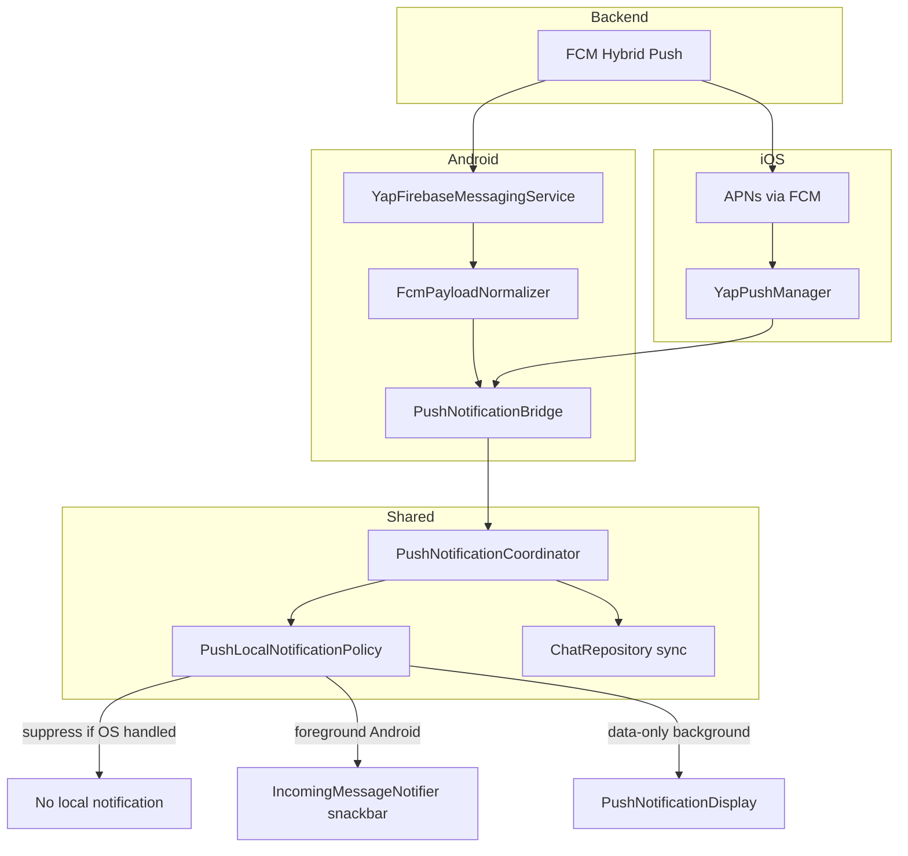

# Client Push Notification Redesign — Implementation Report

## FILES CHANGED

### Modified

| File | Change |
|------|--------|
| `shared/src/commonMain/kotlin/com/yapyap/core/push/PushNotificationCoordinator.kt` | Hybrid delivery context, deduplication policy, conversation dismiss, improved logging |
| `shared/src/commonMain/kotlin/com/yapyap/core/push/PushNotificationBridge.kt` | Passes `PushInboundMessage` with delivery context |
| `shared/src/commonMain/kotlin/com/yapyap/core/push/PushPlatform.kt` | Updated handler signature; `dismissConversationNotification()` |
| `shared/src/commonMain/kotlin/com/yapyap/core/push/PushNotificationContent.kt` | Channel routing, tags, grouping, media image URL |
| `shared/src/commonMain/kotlin/com/yapyap/core/push/model/PushModels.kt` | Media channel, extended payload fields, backend channel ID constants |
| `shared/src/commonMain/kotlin/com/yapyap/core/push/PushPayloadExtensions.kt` | Parses `mediaUrl` from hybrid data |
| `shared/src/androidMain/kotlin/com/yapyap/core/push/FcmPayloadNormalizer.kt` | Hybrid/notification/data detection; merges FCM notification fields into data |
| `shared/src/androidMain/kotlin/com/yapyap/core/push/PushNotificationChannels.kt` | Channel IDs `messages`, `media`, `calls` (match backend) |
| `shared/src/androidMain/kotlin/com/yapyap/core/push/PushNotificationDisplay.kt` | MessagingStyle, tag replacement, group summary, BigPicture, deep link intents |
| `shared/src/androidMain/kotlin/com/yapyap/core/push/PushPlatform.android.kt` | Updated bridge wiring, dismiss support |
| `shared/src/androidMain/kotlin/com/yapyap/core/push/YapFirebaseMessagingService.kt` | Delivers normalized inbound message |
| `shared/src/iosMain/kotlin/com/yapyap/core/push/PushPlatform.ios.kt` | Thread id + stable identifier for local notifications; dismiss handler |
| `iosApp/iosApp/YapPushManager.swift` | OS-handled flag, thread-id, replacement identifiers, foreground dedup |
| `androidApp/src/main/AndroidManifest.xml` | Default FCM channel `messages` |
| `shared/.../ChatViewModel.kt` | Dismisses conversation notification on chat open |
| `shared/.../ChatModule.kt` | Injects `PushNotificationCoordinator` |

### New

| File | Purpose |
|------|---------|
| `shared/src/commonMain/kotlin/com/yapyap/core/push/model/PushDeliveryContext.kt` | Delivery mode + OS-handled flag |
| `shared/src/commonMain/kotlin/com/yapyap/core/push/PushLocalNotificationPolicy.kt` | Central deduplication / in-app / tray rules |

---

## FLOW DIAGRAM



---

## FOREGROUND FLOW

### Android
1. FCM hybrid arrives → `onMessageReceived` (foreground only for notification payloads).
2. `FcmPayloadNormalizer` merges notification + data fields.
3. Coordinator syncs message to DB.
4. If viewing same chat → dismiss notification, stop.
5. If viewing different chat → **in-app snackbar only** (no local tray notification).
6. Socket `message:new` also triggers in-app path; background socket messages do **not** create local notifications (push handles tray).

### iOS
1. Remote push arrives → `willPresent` delegate.
2. Coordinator receives `osNotificationHandled=true`.
3. Data synced; **no local notification created**.
4. System banner shown via `completionHandler([.banner, .sound, .badge])`.

---

## BACKGROUND FLOW

### Android
1. FCM hybrid → **system displays notification** ( `onMessageReceived` not called).
2. User taps → `MainActivity` intent → `handleNotificationOpened` → sync + navigate.
3. FCM data-only → `onMessageReceived` → coordinator shows **local notification** with MessagingStyle + tag `conv_{id}`.

### iOS
1. System displays APNs alert.
2. `didReceiveRemoteNotification` syncs data with `osNotificationHandled=true`.
3. Tap → `deliverNotificationOpened` → sync + navigate.

---

## TERMINATED FLOW

### Android
- Hybrid: OS notification in tray. Tap → cold start → intent extras → `PushIntentParser` → open chat.
- Data-only: OS may not show tray; if `onMessageReceived` ran before kill, local notification may exist.

### iOS
- `launchOptions[.remoteNotification]` → `handleLaunchNotification` → pending open handled after coordinator starts.

---

## REBOOT FLOW

- FCM token persists in Firebase SDK.
- On app resume / foreground → `verifyTokenRegistration()` re-registers with backend if token changed.
- Notifications work after reboot once token was previously registered (standard FCM behavior).

---

## NOTIFICATION TAP FLOW

```
User taps tray notification
  → Android: MainActivity intent extras / iOS: UNNotificationResponse
  → PushNotificationBridge.deliverNotificationOpened
  → PushNotificationCoordinator.handlePushData(fromUserTap=true)
  → syncIncomingPushMessage (if not deduplicated)
  → dismissConversationNotification
  → PushNavigationRouter → Chat screen
```

---

## TOKEN FLOW

```
App start / permission granted / onAppForeground (iOS)
  → pushPlatform.getDeviceToken()
  → deviceRepository.registerDevice (unchanged API)
  → tokenStorage.saveDeviceToken

onNewToken / MessagingDelegate
  → onTokenRefreshed
  → registerWithRetry if authenticated
```

---

## DEDUPLICATION STRATEGY

| Scenario | Behavior |
|----------|----------|
| FCM hybrid, background/killed | OS shows notification; app code never creates local |
| FCM hybrid, foreground Android | In-app snackbar only |
| FCM hybrid, foreground iOS | `osNotificationHandled=true`; banner via delegate |
| Socket + FCM while background | Realtime mode suppresses local; FCM handles tray |
| Same `messageId` twice | `PushMessageDeduplicator` skips re-processing |
| Same conversation | Android tag `conv_{id}` + MessagingStyle replaces prior notification |
| iOS grouping | `threadIdentifier = conv_{id}`, stable request identifier |

---

## TEST CHECKLIST

### Android
- [ ] Foreground hybrid push → snackbar only, no duplicate tray notification
- [ ] Background hybrid push → single system notification (no local duplicate)
- [ ] Data-only background push → local MessagingStyle notification with tag `conv_{id}`
- [ ] Tap notification → opens correct chat, message synced
- [ ] Two messages same conversation → notification replaced (same tag)
- [ ] Image message → `media` channel, BigPicture when URL reachable
- [ ] Call push → `calls` channel
- [ ] Android 13+ permission grant/deny flows
- [ ] Cold start from notification tap
- [ ] Open chat → notification dismissed for that conversation

### iOS
- [ ] Foreground remote push → system banner, no duplicate local notification
- [ ] Background push → system alert
- [ ] Tap → navigates to chat
- [ ] Cold start from `launchOptions` remote notification
- [ ] Thread grouping by conversation in Notification Center
- [ ] Token refresh on foreground

### Cross-cutting
- [ ] Socket message while foreground → in-app only
- [ ] Socket message while background → no local duplicate (FCM handles)
- [ ] Logout → token unregistered

---

## KNOWN LIMITATIONS

1. **Background hybrid without tap** — Message data not synced until tap or app foreground (FCM Android/iOS behavior).
2. **Image BigPicture** — Loaded synchronously on network; may fail on slow/offline (falls back to text).
3. **No Notification Service Extension** — iOS rich images from backend `mutable-content` require NSE (not added).
4. **Badge count** — Not computed from unread total; only call payload may set badge on iOS.
5. **Legacy channel IDs** — Existing installs may retain old `yapyap_messages` channel until app reinstall; new channel IDs are `messages`/`media`/`calls`.
6. **VoIP calls** — Standard alert push, not PushKit.

---

## ANY REMAINING TODO

- [ ] Add iOS Notification Service Extension for `mutable-content` image rendering
- [ ] Compute dynamic iOS badge from unread count
- [ ] Migrate/delete legacy Android notification channels (`yapyap_*`) on upgrade
- [ ] Instrumentation tests for `PushLocalNotificationPolicy`
- [ ] Optional: suppress FCM foreground display on Android using data-only path (requires backend change — not in scope)
